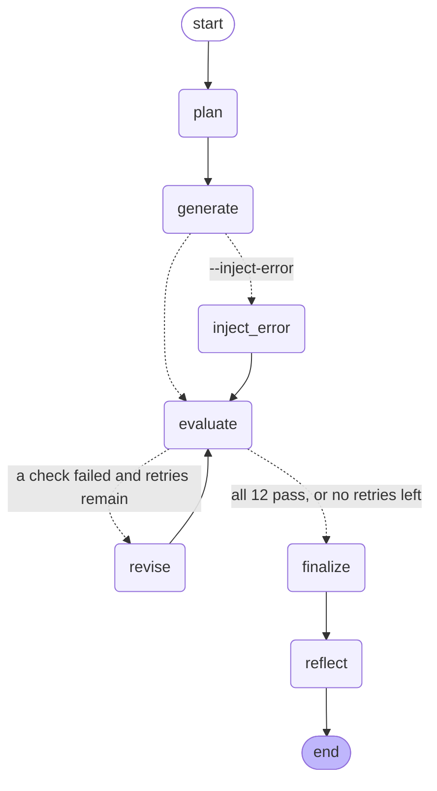

# Self-Evaluating Lesson Generator

An agentic system that **writes a beginner lesson, grades it against a strict pass/fail
rubric, and revises it until it is good enough to ship**, then learns from its mistakes
for the next run.

- **Topic:** Introduction to RAG (Retrieval-Augmented Generation)
- **Learner:** a 12th-grade graduate from India with limited English, starting from zero
- **Stack:** Python 3.11, LangGraph (only for the loop), the OpenAI SDK pointed at Groq.
  GitHub Models, Gemini and OpenAI work too; switching is one line in `.env`.

```
plan -> generate -> evaluate (12 checks) -> pass?  yes -> finalize -> reflect (memory)
                                             no  -> revise -> evaluate ... (max 2 retries)
```

---

## How this meets the brief

| Brief | How it is done here |
|---|---|
| **GENERATE** a standalone beginner lesson | `plan` writes a teaching outline, then `generate` writes the lesson, grounded in a curated [reference sheet](knowledge/rag_reference.md) |
| **EVALUATE** with hard pass/fail checks | 12 checks, no partial credit: 6 deterministic code checks + 6 LLM-judge checks, with an [evidence rule](#the-evidence-rule-keeping-the-judges-honest) so judges cannot fail a lesson over imagined problems |
| **REGENERATE** on fail, max 1–2 retries | Targeted revision of only the failed checks; at most 2 retries, then the best attempt ships as **BLOCKED – needs human review**. The loop always ends |
| **OUTPUT** passing lesson + rejection log | `lesson.md`, `rejection_log.md` (every attempt: what failed, why, evidence, what changed) and `run.json` per run |

### Across the pipeline

**🔁 SELF-EVOLVING: learns from repeated failures to sharpen prompts and rubrics**
- **Prompts sharpen automatically.** After every run, the `reflect` step turns the run's failures
  into short, general writing rules (for example, *"Define every technical term immediately
  before its first use"*). A rule seen again gets its count increased, so **repeated failures
  rise to the top**, and the top rules are added to the generator's prompt on the next run.
  Checks that fail often also become explicit warnings in that prompt.
- **Rubrics sharpen through human feedback.** `feedback --check <id> "note"` adds a reviewer's
  note to that judge's prompt on every future run, with no code changes.
- **Why prompts change automatically but rubrics don't:** if a system could rewrite its own
  grading rules, it could quietly make them easier and pass itself. The writer improves on its
  own; the judges' standards stay under human control.
- **Measured:** `memory show` prints the first-attempt pass rate across runs, the number that
  should rise as rules accumulate.

**🧠 MEMORY: persists across runs; learns from feedback and logs**
- **Persists:** [`memory/memory.json`](memory/memory.json) stays on disk between runs (tested: a
  new run reads what the previous one saved). It is written atomically, so a crash cannot corrupt it.
- **Learns from logs:** every run saves a full log to `outputs/<run_id>/` (`rejection_log.md` for
  people, `run.json` for machines). `reflect` reads the same attempt history (every check's result,
  reason, evidence and fix) and turns it into rules and per-check failure statistics.
- **Learns from feedback:** human notes are stored per check and used by the judges from then on.
- **Learns only from real signal:** planted demo errors and API outages are excluded, so memory
  is not taught wrong lessons.

**🧱 STACK: LangGraph + Python + API, any model**
- **LangGraph** orchestrates the loop (one ~50-line file). Everything else is plain Python.
  LangChain is deliberately not used.
- **Any model:** one OpenAI-compatible client works with **Groq, GitHub Models, Gemini and
  OpenAI**; switching is one line in `.env`, and the writer and judge models are set separately.
  Default: `openai/gpt-oss-120b` writes and `openai/gpt-oss-20b` judges, on Groq's free tier.

---

## Quick start (Windows PowerShell)

```powershell
# 1. Create a virtual environment and install dependencies (Python 3.11+)
py -3.11 -m venv .venv
.\.venv\Scripts\python.exe -m pip install -r requirements.txt

# 2. Add your API key
copy .env.example .env      # then open .env and paste your key, e.g. GROQ_API_KEY=...

# 3. Run the tests (no API key needed - they use a fake LLM)
.\.venv\Scripts\python.exe -m pytest -q

# 4. Generate a lesson
.\.venv\Scripts\python.exe -m lesson_agent run
```

On macOS/Linux use `python3 -m venv .venv` and `.venv/bin/python` instead.

### All commands

| Command | What it does |
|---|---|
| `python -m lesson_agent run` | Plan, write, evaluate and revise a lesson. Writes `outputs/<run_id>/`. |
| `python -m lesson_agent run --inject-error` | Demo: after the first draft, plants a false claim and an undefined term so you can watch the evaluator catch them. |
| `python -m lesson_agent feedback --check <id> "note"` | Saves a human note that is added to that check's judge prompt on future runs. |
| `python -m lesson_agent memory show` | First-attempt pass rate across runs, check failure rates, lessons learned, feedback. |
| `python -m lesson_agent diagram` | Prints the workflow as a Mermaid diagram, generated from the real graph. |

A run takes about 3 to 6 minutes on Groq's free tier, because the client waits out rate limits
(you will see `RateLimitError ... waiting 15s` in the console; this is expected).
The exit code is `0` for PASSED and `2` for BLOCKED, so scripts can tell them apart.

---

## Architecture



*(Generated with `python -m lesson_agent diagram`; edge labels added for readability.)*

| Node | Job |
|---|---|
| **plan** | Writes a short teaching plan: what each section covers, the worked example, and the order in which terms are introduced. |
| **generate** | Writes the full lesson. The prompt includes the reference sheet, the writing rules, and the **top lessons learned from memory**. |
| **inject_error** | Demo only. Plants *"RAG retrains the model on your documents…"* and an undefined term (*reranker*). |
| **evaluate** | Runs all 12 checks (6 code + 6 LLM judges) and records the attempt. |
| **route** | All checks pass → finalize. Fail with retries left → revise. Fail with no retries left → finalize as **BLOCKED – needs human review**. |
| **revise** | Targeted fix: receives only the failed checks (reason, evidence, fix) and must keep everything else unchanged. Returns a list of what it changed. |
| **finalize** | Ships the passing draft, or the best draft (most checks passed) marked BLOCKED. |
| **reflect** | Updates memory: check statistics, the run summary, and new general rules distilled from this run's failures. |

The loop **always terminates**: at most 1 draft + 2 revisions = 3 evaluated attempts. LangGraph's
step limit is set as a second safety net.

---

## The rubric (hard pass/fail, no partial credit)

Every check returns `passed`, a `reason`, `evidence` (the offending text) and a `fix`.

### Code checks: deterministic, free, instant

| id | Check | Pass rule |
|---|---|---|
| `sections` | Required sections | All 7 present with content: What is RAG, Why it matters, How it works, Worked example, Key words, Recap, Check your understanding |
| `word_count` | Word count | 700 to 1800 words of prose |
| `readability` | Readability | Flesch reading ease ≥ 60 **and** average sentence ≤ 16 words (prose only; headings and code ignored) |
| `hard_words` | No hard words | None of the blocklist (`utilize`, `leverage`, `paradigm`, `delve`, `facilitate`, ...), matched by stem |
| `jargon_defined` | Jargon defined | Every known technical term used (LLM, embedding, chunk, token, prompt, retriever, ...) is defined in **Key words** |
| `quiz` | Quiz with answers | ≥ 3 numbered questions, each with an answer |

### LLM-judge checks: one separate call per check, temperature 0

| id | Check | Pass rule |
|---|---|---|
| `accuracy` | Accurate & grounded | No claim contradicts [`knowledge/rag_reference.md`](knowledge/rag_reference.md) |
| `coverage` | Covers key points | Each of the 9 must-cover points in [`topic_spec.json`](knowledge/topic_spec.json) is explained in the main text |
| `unexplained_jargon` | No unexplained jargon | No technical word beyond the known list is used without explanation |
| `worked_example` | Teaches by example | A concrete, relatable example traced through retrieve → augment → generate |
| `flow` | Coherent flow | No concept is used before it is introduced |
| `simple_english` | Simple English | No idioms, slang or figures of speech; no long, complex sentences |

### The evidence rule: keeping the judges honest

LLM judges can imagine problems. So **a judge's FAIL only counts if it quotes the offending
text and code confirms that quote really exists in the lesson.** Made-up quotes are dropped,
and a FAIL with no verified quote is discarded (shown as `PASS*` in the log).

Coverage works the other way round, because missing content has nothing to quote. The judge
must **prove** each must-cover point with a quote, and code checks that the quote is in the main
lesson text (not just in Key words, Recap or the quiz). A point without a verified quote counts
as missing. This was added after a real run in which a lenient judge passed a lesson that
mentioned "limits" only in the Recap.

If a judge gives no usable answer (invalid JSON twice), the check **fails closed**: a lesson
that was not actually checked is never shipped.

---

## Memory and self-improvement

Memory lives in [`memory/memory.json`](memory/memory.json) and persists across runs.

| Part | How it is used |
|---|---|
| **Lessons learned** | After each run, `reflect` turns failures into short, general rules (for example, *"Define every technical term immediately before its first use"*). Rules are deduplicated and counted, and the most frequent ones are added to the generator prompt next time. |
| **Check stats** | How often each check fails. Checks that fail often become warnings in the generator prompt. |
| **Human feedback** | `feedback --check simple_english "Treat 'kick off' as an idiom."` is stored and added to that judge's prompt, which sharpens the rubric without code changes. |
| **Run history** | `memory show` prints the first-attempt pass rate across runs. |

Error-injection runs are **excluded** from learning and from the pass rate, because planted
errors are not real model mistakes.

---

## Outputs

Each run writes to `outputs/<run_id>/`:

- `lesson.md`: the final lesson (with a **BLOCKED** banner at the top if it did not pass)
- `rejection_log.md`: for every attempt, each check's result, reason, evidence and fix, plus what changed before that attempt
- `run.json`: everything, machine-readable (plan, all drafts, all check results, models, rules used)

**Usage tracking:** every model call records its step, model, tokens in/out and time. At the end of
a run the console prints a summary (calls, tokens for the writer and the judge, total time and time
spent waiting for rate limits), and the same numbers go into `run.json` and the top of
`rejection_log.md`. This made the free-tier trade-offs measurable: for example, setting the judge's
`reasoning_effort` to `low` cut a judge call from about 3.6k to about 1.8k tokens.

Sample runs are committed in [`examples/`](examples/):
- [`examples/passing_run/`](examples/passing_run/): a real run that failed attempt 1, was revised, and passed 12/12 on attempt 2
  (recorded with an earlier model pairing, qwen writer and gpt-oss-120b judge, before the switch described under *Design choices*)
- [`examples/error_injection_run/`](examples/error_injection_run/): the evaluator catching both planted errors on attempt 1, a cut-off revision being safely discarded, and the lesson passing 12/12 on attempt 3 (23 model calls, ~67k tokens, ~5.5 minutes, mostly waiting for free-tier rate limits)

---

## Project structure

```
lesson_agent/
  graph.py         LangGraph wiring only (nodes + edges) - the single file that uses LangGraph
  nodes.py         plan, generate, inject_error, evaluate, route, revise, finalize, reflect
  evaluate.py      runs all 12 checks
  checks_code.py   the 6 deterministic checks
  checks_judge.py  the 6 LLM-judge checks + the evidence rule
  prompts.py       every prompt, in one place
  memory.py        memory.json: lessons learned, check stats, feedback, runs
  llm.py           small OpenAI-compatible client with retry/back-off on rate limits
  config.py        providers, models, thresholds, retry budget
  knowledge.py     loads the files in knowledge/
  text_utils.py    sections, sentences, Flesch score, quote matching
  outputs.py       writes lesson.md, rejection_log.md, run.json
  pipeline.py      runs the graph once and writes outputs
  cli.py           command-line interface
knowledge/         reference sheet, topic spec (sections + must-cover), word lists
memory/            memory.json (persists across runs)
tests/             30 tests with a fake LLM (no API key needed)
```

---

## Design choices and trade-offs

**Stack: LangGraph for the loop, plain Python + API for everything else.**
The brief allowed n8n, LangGraph, LangChain or Python + API. I chose LangGraph and Python + API,
and each one paid off in concrete ways during the build:

| Choice | How it helped in this project |
|---|---|
| **LangGraph** for orchestration | The core decision (pass → finalize, fail → revise, out of retries → BLOCKED) is one routing function wired with `add_conditional_edges`: explicit, readable and tested. Adding the `--inject-error` demo step was **one new node and one conditional edge**, with no other step changed. The architecture diagram is **generated from the code**, so it cannot drift out of date. LangGraph's step limit is a second safety net on top of the retry cap. |
| **Plain Python + the OpenAI-compatible API** for everything else | Every real problem found during testing was fixed in a few lines, because the client code is ours: a model Groq had retired (config change), silently cut-off lessons (read the raw `finish_reason`), JSON rejected by the provider (plain-text fallback), token limits (`reasoning_effort`), cost visibility (read the raw `usage`). One small client works with every provider; adding GitHub Models as a backup took 9 lines of config. The 6 code checks are plain functions, and the whole system talks to models through **one method**, so testing offline with a fake model was trivial. |
| **Not LangChain** | It mainly wraps model calls, prompt templates and output parsers. This system needs one thing from a model (send a prompt, get text back) and needed the *raw* response details (finish reason, token usage, rate-limit headers) that wrappers tend to hide. Fewer layers means fewer dependencies and easier debugging. |
| **Not n8n** | A visual, no-code tool that is excellent for connecting apps. The core here is logic (12 checks, quote verification, memory) that needs unit tests and version control, which is simpler in code. |

LangGraph is kept thin: it lives in one ~50-line file, and every node is a plain function (state
in → changed fields out), so the framework could be swapped for a `while` loop in minutes. I also
did **not** use LangGraph's checkpointer: it saves the state of one run, but the memory here must
carry lessons *across* runs, and a JSON file is simpler and easy to inspect.

**Hybrid evaluator: code first, LLM only where code cannot judge.**
Anything measurable (sections, length, readability, blocklists, glossary, quiz) is checked by
code: it is free, instant and gives the same answer every time. LLM judges are used only for
things that need understanding (accuracy, coverage, flow, examples, tone).

**One judge call per check.**
A narrow question gets a sharper answer than "grade this on six things". Each check also gets
its own pass/fail, reason and fix, which the reviser and the rejection log need. The cost is
six calls instead of one per attempt, which is acceptable for content that is about to ship.

**Evidence rule (and proof-based coverage).**
This guards against the two ways a judge can be wrong: a FAIL over an imagined problem, and a
PASS over something that is really missing. Both are turned into checks that code can verify.

**A different model for judging, chosen by testing.**
`openai/gpt-oss-120b` writes and `openai/gpt-oss-20b` judges, so a model never grades its own
work. The choice came from real runs:
- Groq retired the original default model, so the config now checks against Groq's live model list.
- `qwen/qwen3.8-27b` was tried as a judge but missed a flow problem that the gpt-oss models caught.
- qwen was then tried as the generator, but on the free tier it can only produce about 1,000
  output tokens per minute, so long lessons were silently cut off mid-quiz. The client now
  sets an explicit output limit and **rejects any reply cut off at that limit**
  (`finish_reason == "length"`) instead of shipping half a lesson.
- gpt-oss-20b as judge caught every known flaw in a lesson with labelled problems (a term used
  before it was explained, a metaphor).

Free-tier quotas are per model (8k tokens per minute, 200k per day), so the split also matters
for cost. The generator makes few calls (~20k tokens a run) and the judge makes six per attempt
(~60–70k a run), so each job gets its own quota.

**Targeted revision instead of rewriting from scratch.**
The reviser gets only the failed checks and must keep everything else unchanged, so passing
parts do not break. Judges list *every* problem at once, so one revision can fix them all. If
the model forgets to list its changes, code compares the drafts and records the real changes.

**Strict bar plus a BLOCKED state, rather than a lower bar.**
With six strict judges, some runs end BLOCKED after 3 attempts. That is intended: the system
ships nothing it cannot defend, and a BLOCKED lesson comes with a precise rejection log for a
human reviewer. The retry cap (2) keeps cost and latency bounded.

**Thresholds calibrated on real lessons.**
A hand-written reference lesson scored Flesch 77 (average sentence 8.6 words). Real generated
lessons scored 61 to 78; the one that read densely scored about 61. So the bar is ≥ 60 ("plain
English") with a 16-word average sentence cap.

**Trade-offs and known limits**
- Judges are still LLMs: they can occasionally pass a weak lesson or nitpick a fine one. The
  evidence rule, temperature 0 and human feedback notes reduce this but do not remove it.
- The Flesch formula was designed for native-English text; it is a useful signal, not a perfect
  measure of difficulty for non-native readers.
- The topic spec and reference sheet are hand-curated for RAG. A new topic needs its own spec
  and reference (the code itself is topic-agnostic).
- Free-tier rate limits make a run take a few minutes; the client waits and retries rather than
  failing. The daily token cap allows roughly 3 full runs per day on the free tier.

---

## Tests

```powershell
.\.venv\Scripts\python.exe -m pytest -q
```

30 tests, all offline with a scripted fake LLM:
- **Pass path:** a good first draft ships after 1 attempt with all 3 output files.
- **Retry cap:** a judge that always fails stops the loop after exactly 3 attempts and marks it BLOCKED (also with `max_retries=0`, and when a revision itself fails).
- **Error injection:** the code check catches the undefined term, the accuracy judge catches the false claim, and the reviser fixes both.
- **Memory persistence:** rules learned in run 1 are on disk and appear in run 2's generator prompt; feedback reaches only its own judge; demo runs do not pollute memory.
- **Evidence rule:** imagined quotes are discarded, coverage proof from Recap or Key words does not count, and an unusable judge reply fails closed.
- **Code checks:** each check catches its own kind of problem.

---

## Configuration

`.env` (see [`.env.example`](.env.example)):

```
LLM_PROVIDER=groq          # groq | github | gemini | openai
GROQ_API_KEY=...
# GENERATOR_MODEL=...      # optional overrides
# JUDGE_MODEL=...
```

Retries, temperatures and thresholds are in [`lesson_agent/config.py`](lesson_agent/config.py).
